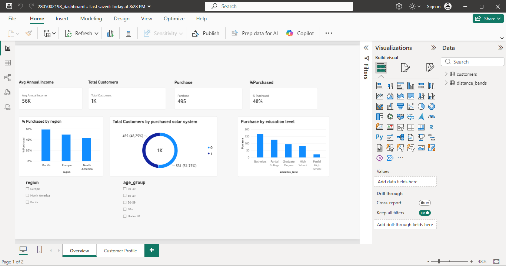
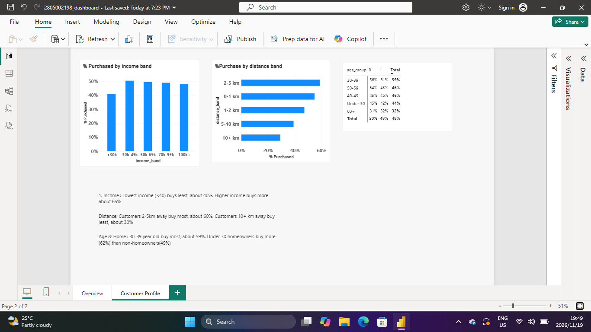

# ☀️ Solar System Purchase Dashboard

> *Did they buy it or not?* This dashboard answers that in ONE look.

Built in Power BI. 1,026 customers. One clear story: *Almost half said YES to solar.*

---

##  SCREENSHOTS 

### 1. Overview - The Big Picture

### 2. Customer Profile - Who Actually Buys?

---

##  THE HEADLINE NUMBERS
Metric | Result
Avg Annual Income | 56K
Total Customers | 1,026
Purchased | 495
% Purchased | 48.25%
*TRANSLATION:* 495 people bought. 531 didn't. It's almost 50/50 - and THAT'S where the story gets interesting.

---

##  WHAT I FOUND 

###  INCOME MATTERS 
Lowest income (<30k) buys least, around 40%. Higher income (30k+) buys way more - up to 50%. Money talks.

###  DISTANCE MATTERS 
Customers *2-5 km away* buy the MOST, about 60%.
Customers *10+ km away* buy the LEAST, about 30%.
*If you're far, you're less likely to buy.*

###  AGE MATTERS 
*30-39 year olds* are the golden buyers - *59%* purchased!
60+ buys the least - only *32%*.

###  REGION MATTERS 
- *Pacific:* 59% purchased - the WINNER
- *Europe:* 48%
- *North America:* 44%

### 🎓 EDUCATION MATTERS 
*Bachelors* buy the most (170+). *Partial High School* buys the least.

---

## 🛠️ BUILT WITH

- Power BI Desktop
- DAX Measures (% Purchased, Total Customers)
- Data Cleaning, Grouping & Banding (Income Band, Distance Band, Age Group)
- Interactive Slicers for Region & Age

---

## 🎯 Why This Matters

Solar companies shouldn't waste time marketing to everyone the same way.

This dashboard says: *Target 30-39 year olds, in the Pacific, with a Bachelors degree, living 2-5km away.* That's your buyer.

KULANI PRECIOUS CHUMA 

*Student No: 2805002198*
