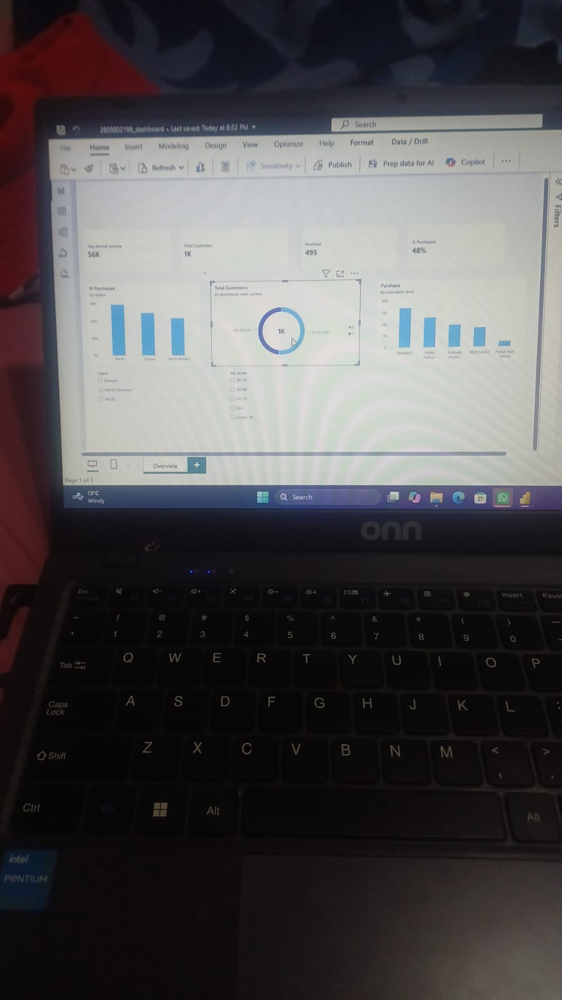
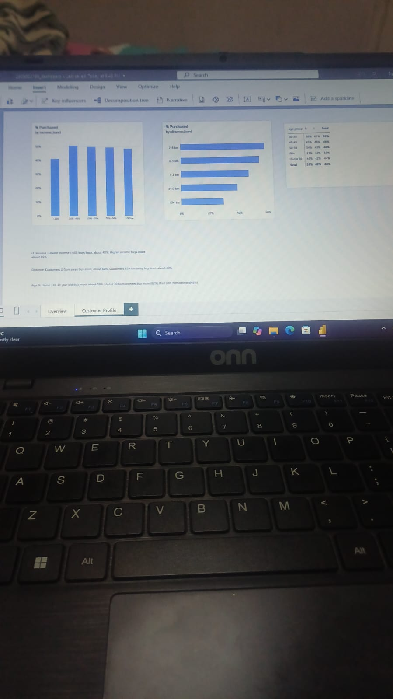

# ☀️ SunVolt - Who Will Buy Solar?

This project finds out which customers are most likely to buy a solar system.

## 📊 Dashboard

### Overview

### Customer Profile

## 🛠️ Tools
- Power BI - Dashboard
- SQL - Data Analysis

## 🔍 What I Found
- Total Customers: 1K | Purchased: 495 | Purchase Rate: 48% | Avg Income: 56K
- Higher income buys more - ~65% vs ~40% for low income
- Close customers buy more - 2-5km: ~60% vs 10km+: ~30%
- 30-39 year olds buy most - ~59%
- Homeowners under 30 buy more - 82% vs 49% for non-homeowners

## ✅ Recommendation
Target higher-income, 30-39 year old homeowners within 5km - they buy most.

## 💻 SQL
SQL was used to clean and analyse the data before building the Power BI dashboard. All SQL files are in this repo.
